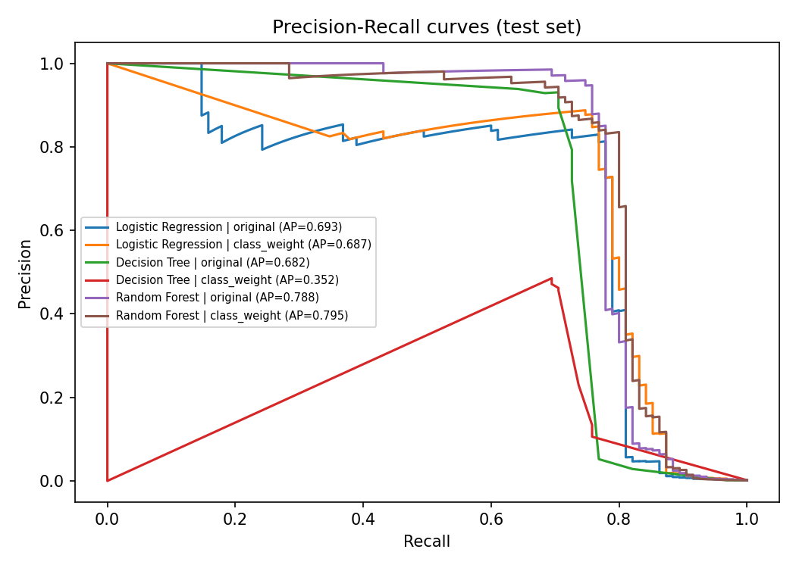
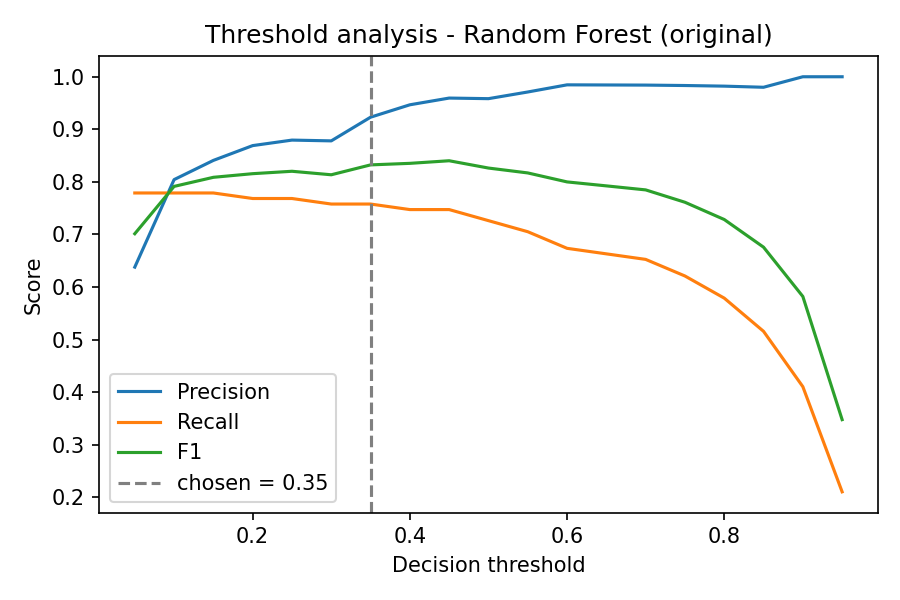
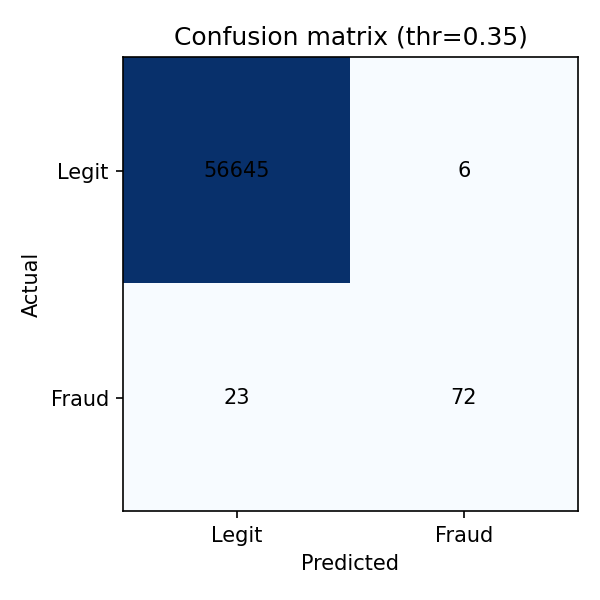
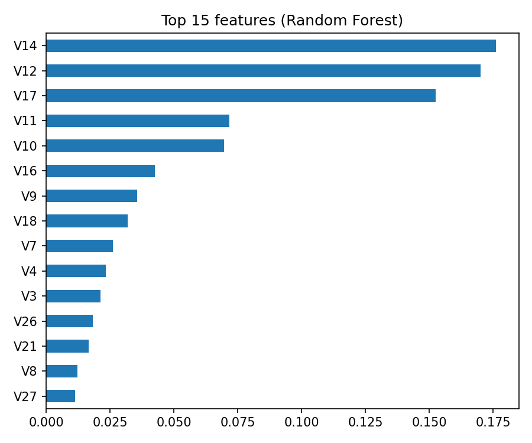

# Credit Card Fraud Detection System Using Machine Learning

Minor project (BCA). Compares Logistic Regression, Decision Tree and Random Forest on an
imbalanced transaction dataset and provides a small Flask demo.

## 1. Setup
```
pip install -r requirements.txt
```

## 2. Dataset
Download `creditcard.csv` (Kaggle: "Credit Card Fraud Detection" by MLG-ULB) and place it at:
```
data/creditcard.csv
```
Columns: Time, V1..V28, Amount, Class (1 = fraud).

## 3. Train and evaluate
```
python train.py --data data/creditcard.csv
```
Optional: add `--smote` to also test SMOTE. For a quick test without the dataset: `python train.py --demo`.
Random Forest on the full dataset can take a few minutes.

Created in `outputs/`: model_comparison.csv, threshold_analysis.csv/.png, pr_curves.png,
confusion_matrix.png, feature_importance.csv/.png, final_report.json.
Created in `models/`: best_model.joblib, sample_transactions.json.

## 4. Run the demo
```
python app.py
```
Open http://127.0.0.1:5000 and click a sample button, then Predict.
The demo samples are the fraud cases the model is most confident about (for a clean demonstration)
plus some legitimate cases - mention this in your report; use real test results from `outputs/` for evaluation.

## Method (matches synopsis)
- Duplicates/missing values removed; Time and Amount scaled (fit on training data only)
- Stratified split: 64% train, 16% validation, 20% test
- Imbalance handling: original distribution vs class weights (optional SMOTE on training data only)
- Metrics: accuracy, precision, recall, F1, ROC-AUC, AUC-PR, confusion matrix
- Best model chosen on the validation set (AUC-PR); decision threshold also chosen on the validation set
- Threshold analysis on the test set; Random Forest feature importance
- Limitation: single dataset, anonymised features (V1-V28), no concept-drift or real-time testing

## Results

Dataset: Kaggle "Credit Card Fraud Detection" (MLG-ULB). 284,807 transactions, 283,726 after removing
duplicates; 473 frauds (0.167%). Split: 64% train, 16% validation, 20% test (stratified, random_state=42).
Test set contains 95 fraud cases.

### Model comparison (test set, threshold 0.5)

| Model | Imbalance handling | Precision | Recall | F1 | ROC-AUC | AUC-PR |
|---|---|---|---|---|---|---|
| Logistic Regression | Original | 0.849 | 0.590 | 0.696 | 0.949 | 0.693 |
| Logistic Regression | Class weight | 0.052 | 0.874 | 0.098 | 0.962 | 0.687 |
| Decision Tree | Original | 0.930 | 0.695 | 0.795 | 0.889 | 0.682 |
| Decision Tree | Class weight | 0.106 | 0.758 | 0.186 | 0.877 | 0.353 |
| Random Forest | Original | 0.958 | 0.726 | 0.826 | 0.962 | 0.788 |
| Random Forest | Class weight | 0.907 | 0.716 | 0.800 | 0.942 | 0.795 |

Accuracy was between 97.3% and 99.95% for every model, so accuracy alone does not separate them.

### Selected model

Random Forest (original distribution), chosen by validation AUC-PR. Decision threshold 0.35 (chosen on the validation set).

| Precision | Recall | F1 | ROC-AUC | AUC-PR | TP | FP | FN | TN |
|---|---|---|---|---|---|---|---|---|
| 0.923 | 0.758 | 0.832 | 0.962 | 0.788 | 72 | 6 | 23 | 56645 |

### Observations

- Class weights raised Logistic Regression recall from 0.59 to 0.87 but precision fell to 0.05 (1,517 false alarms).
- Raising the threshold reduces false alarms but misses more fraud (see threshold analysis).
- Most important Random Forest features: V14, V12, V17.

### Plots






Full tables: `outputs/model_comparison.csv`, `outputs/threshold_analysis.csv`, `outputs/feature_importance.csv`.

### Limitations

Single dataset with anonymised features; only 95 fraud cases in the test set, so results can vary with a different split; no concept-drift or real-time evaluation. This is an academic prototype, not a production system.
